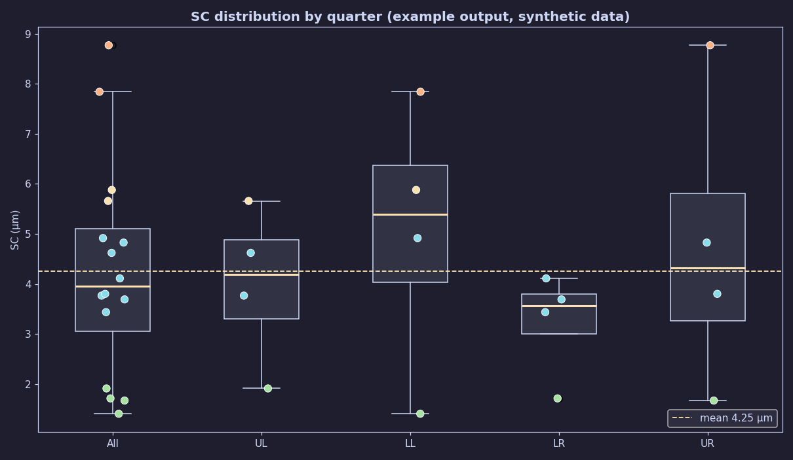
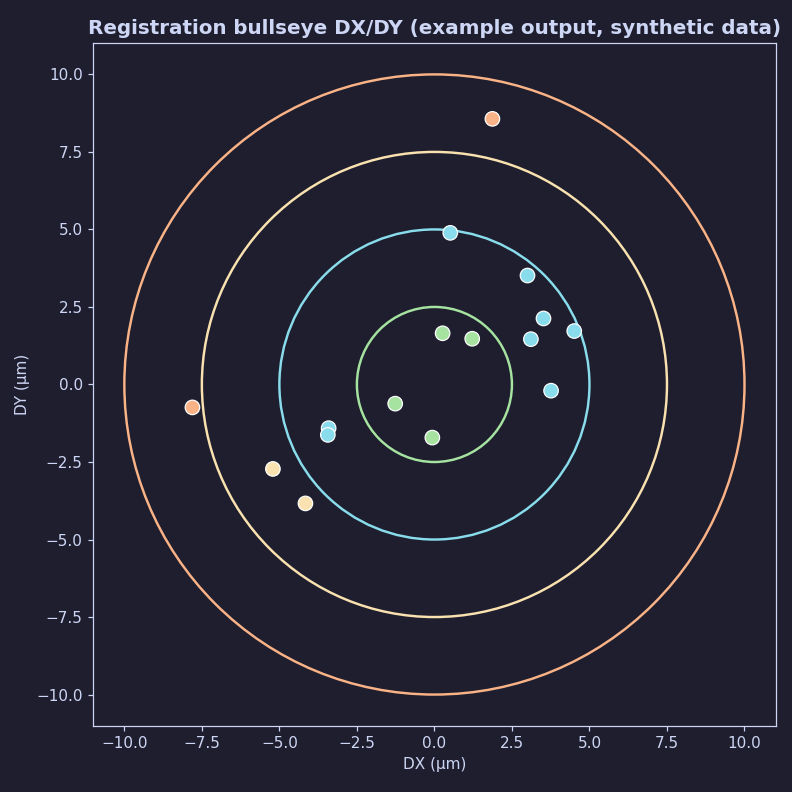
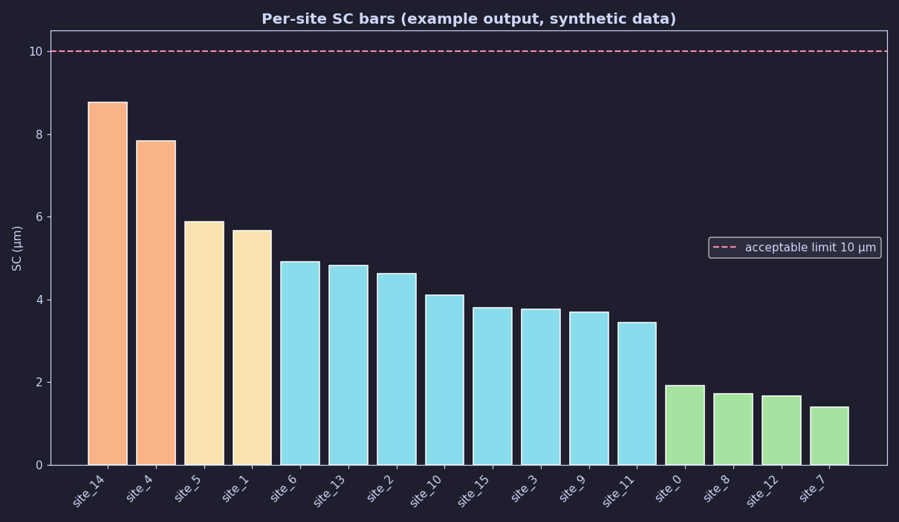

# QVM Manufacturing Dashboard

A Streamlit dashboard for analyzing PCB Quality Vision Machine (QVM) text logs:
it parses registration measurements, flags alignment errors, tool wear and
lamination distortion, and exports Excel workbooks with embedded charts.

> Built by Prince Khurana

## The problem with the raw data

The machine spits out plain `.txt` logs — blocks like this, 16 per file
(one per fiducial site):

```text
Circle: Pad_LL_2(ID:1, From 180 Pts.)
     Coord. X =        63.857203
     Coord. Y =       104.634501
     Diameter =         0.308911
Distance: PtV_LL_2(ID:3) between Via_LL_2(ID:2) and Pad_LL_2(ID:1)
           SC =         0.003728
           DX =         0.000592
           DY =         0.003681
```

In theory, every file looks like that. In practice, none of it can be trusted
at face value:

- **The exporter varies.** Headers go missing (`Circle: Pad` / `Distance:`
  labels absent), naming flips (`Via_LL_2` vs `LL2_Via`), blocks arrive in any
  order. A parser written for one file shape dies on the next.
- **Coordinates are optional.** Some files carry values only; others are
  exported in per-site *local* coordinates (all positions within 1 mm), so
  geometry alone cannot tell the 16 sites apart.
- **The filename lies sometimes.** Panel and side come from the filename,
  which operators mistype. The name is only ever treated as a hint.
- **The optics are noisy.** Each circle is fitted from a handful of edge
  points (`Pts.`) — fewer points, less trustworthy center and diameter — while
  real misalignment and shrinkage hide inside the same numbers.

## What this dashboard does about it

- **One format-agnostic parser** reads values and coordinates from whatever
  labels exist, then resolves site identity geometrically instead of trusting
  names or block order.
- **Graceful, loud fallbacks:** corner names first, then documented measurement
  order — always with a warning, never silent.
- **Content decides, filename hints:** Pad-to-Via vs Via-to-Pad is detected
  from the file; disagreements with the filename raise a warning. Per-file
  sidebar overrides beat the filename; the filename beats `Unknown`.
- **One shared table builder** feeds the on-screen table and the Excel export,
  so the two can never disagree about columns, units, or sorting.
- Tolerance zones, outlier flags, and one-click Excel workbooks with embedded
  charts turn the raw log into something a process engineer can act on.

Full format details: [qvm_dashboard/README.md](qvm_dashboard/README.md).
Method rationale: [SHRINKAGE_METHODS.md](qvm_dashboard/SHRINKAGE_METHODS.md).

## Screenshots

Example outputs (synthetic data — the app renders interactive Plotly versions
of the same charts):





## Features

- Parses three machine formats: Pad-to-Via, Via-to-Pad, and Core Shrinkage logs
- Unified parser: content-based format detection, geometry-resolved site identity
- Interactive charts: bullseye DX/DY scatter, SC box plot by quarter, per-site
  bars, distortion/quiver map, shrinkage panels
- Quality Control table + one-click Excel export with embedded charts
- Config-driven tolerances and limits (`qvm_dashboard/config/settings.yaml`)
- Runs locally or in Docker (non-root, includes browser for chart export)

## Quick start

Requires Python 3.10+.

```bash
pip install -r qvm_dashboard/requirements.txt
cd qvm_dashboard && streamlit run app.py
```

Open `http://localhost:8501`, then upload a sample log to see it working:

- `qvm_dashboard/sample_data/C4F_Core_Shrinkage_Panel 28_Front_CAMorder.txt`

Or with Docker (no local Python needed):

```bash
docker build -t qvm-dashboard .
docker run --rm -p 8501:8501 qvm-dashboard
```

## Tech stack

Python, Streamlit, Plotly, pandas, NumPy, openpyxl, kaleido, PyYAML — pytest
for tests, Docker for deployment.

## Project layout

```text
QVM/
├── Dockerfile                    # runnable without local Python
├── pyproject.toml                # pytest configuration
└── qvm_dashboard/
    ├── app.py                    # entry point
    ├── README.md                 # full docs: formats, views, config, columns
    ├── ARCHITECTURE.md           # module graph, data flow, where-to-change-what
    ├── SHRINKAGE_METHODS.md      # method comparison and rationale
    ├── config/settings.yaml      # tolerances, limits, mappings
    ├── sample_data/              # example logs to try
    └── tests/                    # pytest suite
```

Full documentation: [qvm_dashboard/README.md](qvm_dashboard/README.md) |
[ARCHITECTURE.md](qvm_dashboard/ARCHITECTURE.md) |
[SHRINKAGE_METHODS.md](qvm_dashboard/SHRINKAGE_METHODS.md)

## Tests

```bash
.venv/bin/pytest -q
```

## Limitations / roadmap

- Chart PNG export needs a local Chrome via kaleido; without it, workbooks
  fall back to placeholder graphics.
- Sample data is synthetic; validated against real machine-log shapes only.

## License

MIT — see [LICENSE](LICENSE).
