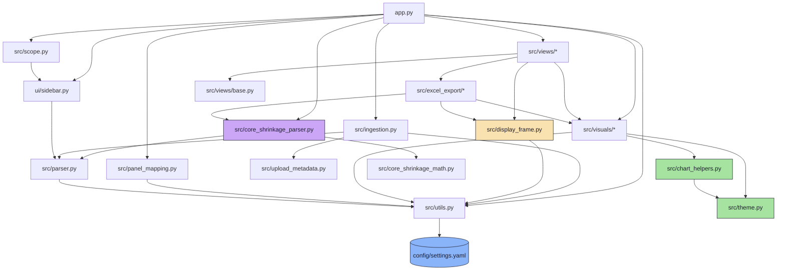
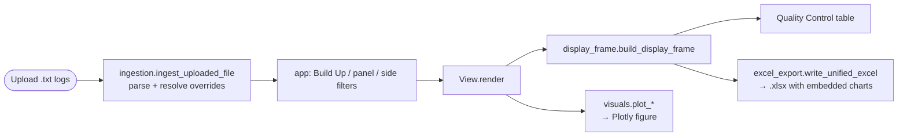
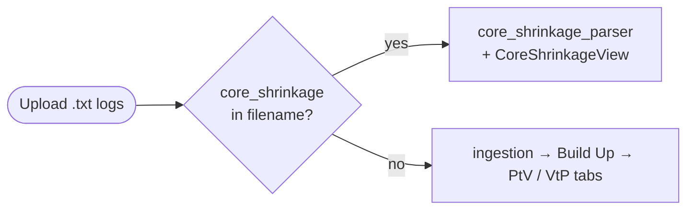

# Architecture — QVM Dashboard

A map for new engineers: how the pieces fit, how data flows, and **where to change what**.

---

## Module dependency graph

Who imports whom. Arrows point from a module to what it depends on. `theme.py`
sits at the bottom — it imports nothing from the project, so there are no cycles.



**Two sources of truth, by design:**
- `config/settings.yaml` — runtime / user-tunable values (column names, tolerances, ring thresholds, slider ranges, chart heights, diagnostics constants). Loaded once via `utils.load_settings()`.
- `src/theme.py` — pure visual design tokens (the Catppuccin Mocha palette, zone/arrow/quarter colours, 4×4 grid geometry, quarter maps). Imported directly by chart code.

---

## Data flow



Both the on-screen table and the Excel measurement sheets are built by
`display_frame.build_display_frame`, so they cannot disagree about which
columns exist, what units they are in, or how they are sorted.

Parsing and workbook construction are both memoised with `st.cache_data`
(`app._parse_upload`, `quality_control.build_workbook`). Streamlit reruns the
whole script on every widget interaction, so without that the app re-parsed
every file and re-rendered every Excel chart on each nav click.

Routing is content-driven for the two QVM formats, but parsing now runs through
one unified engine: `parser.parse_qvm_content` extracts site measurements from
both formats, tags each row with process (`Pad to Via` / `Via to Pad`), then
assigns canonical site identity from coordinates. Filename metadata still only
contributes Panel / Side hints.

**Core Shrinkage is the exception** — a different log format with a different
parser, so it is routed by filename (`core_shrinkage`) *before* the QVM parser
sees the file, and analysed on its own frames. It shares only the scope-filter
widgets and the Excel plumbing, and sits outside the Build Up selector because
its filenames carry no Build Up token:



---

## The `visuals` package

`src/visuals/` was split from a single 1000-line file into focused modules.
The package `__init__.py` re-exports every public name, so
`from src.visuals import plot_quiver` still works.

| Module | Charts |
|--------|--------|
| `bullseye.py` | `plot_vtp_bullseye`, `plot_vtp_site_bars` |
| `quiver.py` | `plot_quiver` (ABF distortion map) |
| `distribution.py` | `plot_vtp_box` (SC distribution by quarter) |

`__all__` lists exactly the charts the dashboard renders — a test enforces it,
so a chart that loses its last caller shows up rather than lingering.

Every chart pulls colours from `theme` and shared logic from `chart_helpers`
(`get_rings`, `zone_color`/`zone_colors`, `apply_dark_layout`,
`stats_card_annotation`, `zone_legend_annotation`).

---

## Where do I change…?

| I want to change… | Edit this |
|-------------------|-----------|
| A **colour** / the dark theme | `src/theme.py` (change `PALETTE`; everything derives from it) |
| A **threshold, tolerance, slider range, chart height** | `config/settings.yaml` |
| How a **specific chart looks** | `src/visuals/<chart>.py` |
| Logic shared by all charts (rings, zone colours, layout) | `src/chart_helpers.py` |
| **Add a new chart** | new module in `src/visuals/`, then re-export it in `src/visuals/__init__.py` |
| Which **columns appear in the table or the export** | `src/display_frame.py` (both read from it) |
| The **Excel sheet layout** | `src/excel_export/qvm.py` (QVM) or `src/excel_export/cs.py` (Core Shrinkage); shared bits in `src/excel_export/_shared.py` |
| The QC **stats tiles / fail highlighting** | `src/views/quality_control.py` |
| Unified coordinate-first parsing of both QVM formats | `src/parser.py` |
| Core Shrinkage **parsing or frames** | `src/core_shrinkage_parser.py` |
| Core Shrinkage **geometry maths** (affine fit, outliers, classification) | `src/core_shrinkage_math.py` (pure; no settings, no I/O) |
| **Scope filters** (Panel / Side / Build Up rules + widgets) | `src/scope.py` |
| A Core Shrinkage **sub-view** | `src/views/core_shrinkage.py` |
| Registration shrinkage **maths** (company method) and the design quadrant size | `src/registration_shrinkage.py` (pure) |
| Registration shrinkage **on screen** | `src/views/registration_shrinkage.py` (the Shrinkage sub-view of both process tabs) |
| The **Documentation** tab | `src/views/documentation.py` (its example runs through the same functions) |
| The **design size boxes** in the sidebar | `ui/sidebar.py` → `with_design_lengths` in `app.py` |
| Registration shrinkage **charts** / **workbook** | `src/visuals/shrinkage.py` / `src/excel_export/shrinkage.py` |
| Registration **design positions**, measured point, limit | `config/settings.yaml` → `REGISTRATION_SHRINKAGE` |
| **Nominal panel geometry / shrinkage specs** | `config/settings.yaml` → `CORE_SHRINKAGE` |
| **Navigation / tabs / ingestion** | `app.py` |
| The **panel-map** figure | `src/panel_mapping.py` |

---

## Conventions

- Chart functions are **pure**: `(df, settings) -> go.Figure`. No Streamlit, no I/O.
  So are `display_frame.build_display_frame` and `quality_control.annular_stats`,
  which is what makes them testable without a Streamlit runtime.
- `src/excel_export/*` is Streamlit-free too: user-facing warnings flow through
  an injected `warn` callback (the app passes `st.sidebar.warning`), so the
  workbook code imports and tests without a Streamlit runtime.
- Column-name fallbacks live in exactly one place: `utils.resolve_columns`
  (backed by `_COLUMN_DEFAULTS`). Views use `BaseView.cols(...)`; chart and
  parser code calls `resolve_columns` directly. Never add a second inline
  `'Default'` string.
- Views subclass `BaseView` and read their config slices in `__init__`.
- All measurements are stored in **mm** and converted to **µm** (`× 1000`) at display time.
- The instrument's centre-to-centre distance is stored **once**, under
  `COLUMN_NAMES.ptv_distance`. The Via-to-Pad header `VtP Distance (SC)` is a
  display label applied in `build_display_frame` — not a second column.
- QVM site identity is coordinate-first: parser output location (`UL_1` ...
  `UR_4`) is derived from geometry, not strict header naming or block order.
- Core Shrinkage measures against `CORE_SHRINKAGE.NOMINAL_COORDS`. Without it
  the view degrades to raw coordinate tables rather than failing, and every
  reader accesses the block through `.get()` defaults — which is why it is
  deliberately *not* in `utils._REQUIRED_SETTINGS_KEYS`.
- Excel chart embedding requires **`kaleido>=1`** (`fig.to_image`) and a local
  Chrome installation. Each chart is embedded independently: if one fails, a
  placeholder image is written in its place with a sidebar warning, and the
  rest of the workbook is unaffected.

## Running tests

```bash
pytest      # run from the repository root; see pyproject.toml
```
