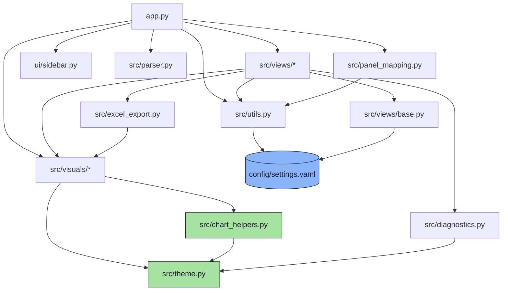
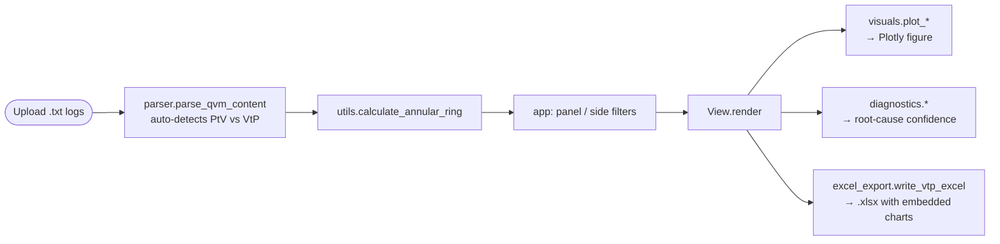

# Architecture — QVM Dashboard

A map for new engineers: how the pieces fit, how data flows, and **where to change what**.

---

## Module dependency graph

Who imports whom. Arrows point from a module to what it depends on. `theme.py`
sits at the bottom — it imports nothing from the project, so there are no cycles.



**Two sources of truth, by design:**
- `config/settings.yaml` — runtime / user-tunable values (column names, tolerances, ring thresholds, slider ranges, chart heights, diagnostics constants). Loaded once via `utils.load_settings()`.
- `src/theme.py` — pure visual design tokens (the Catppuccin Mocha palette, zone/arrow/quarter colours, 4×4 grid geometry, quarter maps). Imported directly by chart code.

---

## Data flow



Routing is **content-driven**: `parser.parse_qvm_content` decides Pad-to-Via vs
Via-to-Pad from the file body. The filename only contributes Panel / Side metadata.

---

## The `visuals` package

`src/visuals/` was split from a single 1000-line file into focused modules.
The package `__init__.py` re-exports every public name, so
`from src.visuals import plot_quiver` still works.

| Module | Charts |
|--------|--------|
| `bullseye.py` | `plot_vtp_bullseye`, `plot_vtp_site_bars` |
| `quiver.py` | `plot_quiver` (ABF distortion map) |
| `distribution.py` | `plot_vtp_box` (SC distribution by quarter) |
| `heatmap.py` | `plot_heatmap` (PtV distance grid) |
| `panel_image.py` | `get_panel_image_path` |

Every chart pulls colours from `theme` and shared logic from `chart_helpers`
(`get_rings`, `zone_color`/`zone_colors`, `apply_dark_layout`,
`stats_card_annotation`, `zone_legend_annotation`).

---

## Where do I change…?

| I want to change… | Edit this |
|-------------------|-----------|
| A **colour** / the dark theme | `src/theme.py` (change `PALETTE`; everything derives from it) |
| A **threshold, tolerance, slider range, chart height** | `config/settings.yaml` |
| How a **specific chart looks** | `src/visuals/<chart>.py` |
| Logic shared by all charts (rings, zone colours, layout) | `src/chart_helpers.py` |
| **Add a new chart** | new module in `src/visuals/`, then re-export it in `src/visuals/__init__.py` |
| **Pattern-detection / root-cause** math | `src/diagnostics.py` |
| The **data table / Excel export** | `src/views/quality_control.py`, `src/excel_export.py` |
| **Parsing** of the QVM log format | `src/parser.py` |
| **Navigation / tabs / ingestion** | `app.py` |
| The **panel-map** figure | `src/panel_mapping.py` |

---

## Conventions

- Chart functions are **pure**: `(df, settings) -> go.Figure`. No Streamlit, no I/O.
- Views subclass `BaseView` and read their config slices in `__init__`.
- All measurements are stored in **mm** and converted to **µm** (`× 1000`) at display time.
- Excel chart embedding requires **`kaleido`** (`fig.to_image`). Without it the
  export still runs but chart images are skipped with a sidebar warning.

## Running tests

```bash
PYTHONPATH=. pytest tests/      # run from the qvm_dashboard/ directory
```
